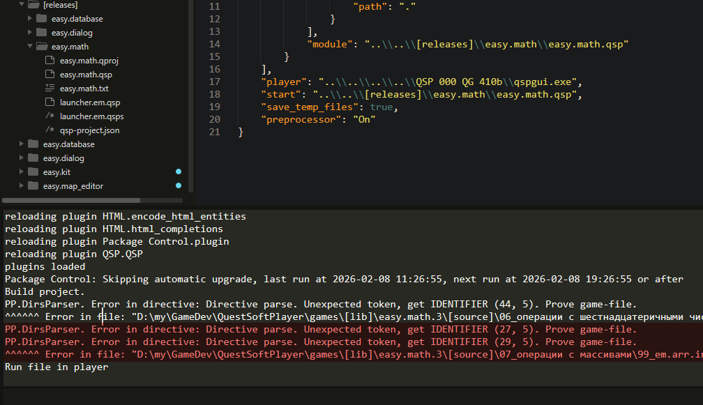

# Препроцессор. Руководство по использованию

Препроцессор - это набор команд предобработки исходного текста программы перед компиляцией. В нашем случае, до того, как мы сконвертируем файлы проекта в конечные файлы "`.qsp`", мы можем исключить из этих файлов некоторые строки, или рекомбинировать их.

Препроцессор написан с нуля, поэтому будут баги и логические ошибки в работе команд. Я ни разу не пользовался сторонними препроцессорами, поэтому могу изобрести велосипед там, где все гоняют на Kawasaki z900. Будьте аккуратны и делайте побольше коммитов.

> [!warning] Внимание
> **При препроцессинге билдер работает в несколько раз медленнее.**

## Cинтаксические правила

### Общее

1. Все команды препроцессора (директивы), а так же спец-комментарии являются обычными комментариями с точки зрения синтаксиса QSP и не влияют на логику вашего кода.
2. Директивы препроцессора (далее "директивы") записываются в отдельных строках кода, однако допускается преформатирование, т.е. отступы в начале строки перед директивой.
3. Спец-комментарии записываются, как обычные комментарии QSP, в т.ч. они могут быть многострочными.
4. Спец-комментарии не учитываются внутри строк, фигурных скобок, а так же в конце обычных комментариев.
5. Директивы, записанные внутри строк и фигурных скобок, валидны и нормально работают.
6. Директивы записанные в многострочных комментариях являются частью комментария.
7. Самостоятельная невалидная директива воспринимается препроцессором, как спец-комментарий.
8. Блоки условий, образованные директивами препроцессора, поддерживают скобочную вложенность. Т.е. первый `endif` закрывает последний `if`.
9. Имена меток и значений могут содержать только числа, буквы и символ подчёркивания, и не должны совпадать с ключевыми словами директив препроцессора.
10. Имена меток и ключевые слова регистрозависимы. `NoSaveComm` и `nosavecomm` — разные слова. Первое может быть именем метки, а второе только ключевым словом директивы препроцессора.

### Спец-комментарии

* `!@` — комментарий, начинающийся с такого сочетания символов, будет удалён при препроцессинге. (простой спец-комментарий)
* `!@<` — комментарий, начинающийся с такого сочетания символов, а так же строка, в которой стоит этот комментарий, будут удалены при препроцессинге. (спец-комментарий с удалением)

### Директивы

В начале каждой директивы записывается ключ `!@pp:`.

* `!@pp:on` — включает препроцессор до конца файла, или до специального отключения. Эта команда будет работать только в режимах "On" и "Off". См. раздел [Включение препроцессора](#Включение%20препроцессора).
* `!@pp:off` — выключает препроцессор до конца файла. Будет работать только в режимах "On" и "Off". См. раздел [Включение препроцессора](<#Включение препроцессора>)
* `!@pp:savecomm` - данная команда **отключает** обработку специальных комментариев. То есть и специальные комментарии и те строки, которые помечались такими комментариями под удаление не будут удаляться. Действует до конца файла.
* `!@pp:nosavecomm` - данная команда **включает** обработку специальных комментариев. Действует до конца файла.
* `!@pp:var(name=123)` - данная команда объявляет метку *name* со значением **"123"**. Имена меток и значения могут содержать только числа, буквы и символ подчёркивания. Допустимо объявлять метку без указания значения: `var(layer)`.
* `!@pp:if(name==123):exclude` - данная команда проверяет, выполняется ли условие в скобках (содержит ли метка *name* значение **"123"**), и если условие выполняется, исключает нижеследующие строки кода из конечного файла. Вместо слова `exclude` можно использовать другие ключевые слова (в любых комбинациях через пробел):
	* `exclude` — **исключить** последующие строки **из конечного файла** при выполнении условия. Если условие не выполнено, строки будут обработаны препроцессором и включены в конечный файл.
	* `include` — последующие строки должны быть **включены в конечный файл** при выполнении условия, при этом строки будут обработаны препроцессором. Если условие не будет выполнено, строки не будут включены в конечный файл.
	* `off` - выключить препроцессор до конца блока условия. При этом не будут обрабатываться директивы и спец-комментарии.
	* `on` - до конца блока условия, даже если строки исключаются из файла, они будут обработаны препроцессором, т.е. выполнятся все директивы внутри блока условия.
	* `savecomm` — не обрабатывать специальные комментарии.
	* `nosavecomm` — обрабатывать специальные комментарии.
	Можно комбинировать ключевые слова (например, `exclude off` и `include off`).
	Содержимое скобок при проверке условия может содержать следующие операции (в порядке повышения приоритета):
	* `or` — логическое **ИЛИ**. Проверка верно ли хотя бы одно условие.
	* `and` — логическое **И**. Проверка, верны ли оба условия одновременно.
	* `not` — логическое **НЕТ**. Верно, если выражение неверно.
	* `==` — проверка равны ли два значения. Верно если равны.
	* `!=` — проверка не равны ли два значения. Верно если не равны. Приоритет такой же, как у `==`.
* `!@pp:endif` - данная команда указывает окончание блока условия.
* `!@pp:const(name='Aleks')` — директива объявления констант. Константы не имеют пересечений с метками и их значениями и не используются в сравнении и условиях. Константы нужны для замены определённых вхождений пользовательских функций на конкретные значения. Подробнее см. [Работа констант](#Работа%20констант).

## Некоторые особенности работы

1. Препроцессор не просто вырезает и вставляет строки, он фактически разбирает ваш код на составляющие, а потом по новой собирает его. Будьте внимательны, некоторые пробелы между операторами, разделёнными `&` могут пропасть.
2. Все команды препроцессора удаляются из конечного файла при препроцессинге. Есть исключения, когда обработка отключается по вашему желанию.
3. Специальные комментарии не будут обрабатываться, если они размещены внутри кавычек или фигурных скобок.
4. Команды препроцессора будут выполняться даже в том случае, если они размещены внутри строковых значений QSP, если записаны согласно требованиям синтаксических правил:
```qsp
	*pl "Текстовое значение, разбитое на несколько строк
	!@pp:if(layer):exclude
	Данные строки будут исключены из конечного файла,
	если метка layer была определена.
	!@pp:endif
	А эта строка останется в конечном файле"
```
5. Все объявленные метки и константы будут глобальны для всего проекта. Будьте внимательны при организации работы препроцессора.
6. Объявляя метку через не объявленную метку, вы тем самым создаёте обе метки: `var(one = two)`
7. `True` и `False` — это метки, которые определены заранее по умолчанию. Их нельзя переопределить. В отличие от всех прочих меток, они всегда ссылаются на булевые значения, поэтому с их помощью можно явно проверять существование меток: `if(build_em!=True)` или `if(build_em==False)`. Объявленная метка при сравнении с `True` вернёт `True` оператору условия. Однако рекомендую проверять существование метки, написав просто: `if(build_em)`.
8. При обработке препроцессором все строки между локациями убираются из конечного файла. Это немного ускоряет конвертирование при сборке.
9. Если вы используете многострочные текстовые значения в команде QSP, а в конце записан спец-комментарий с удалением, удалится не только строка с таким спец-комментарием, но и вся команда.
10. Даже в режиме "Off" препроцессор продолжает обрабатывать файлы, поэтому могут пропадать пустые строки в коде локаций.

## Включение препроцессора

1. Включить препроцессор сразу для всего проекта можно, указав в "`qsp-project.json`" значение "`On`":
	```json
	"preprocessor": "On",
	```
	При этом абсолютно все файлы будут подвергаться препроцессингу, в т.ч. исходники модулей. Всё, что собирается проектом, будет обработано перед сборкой. Исключение составляют файлы, для которых препроцессинг отключается командой `!@pp:off`.
2. Включить препроцессор только для одного файла можно командой:
	```
	!@pp:on
	```
	Если препроцессор выключен выставлением режима "`Hard-off`", данная команда работать не будет.

## Выключение препроцессора

1. Для всего проекта можно использовать значение в "`qsp-project.json`" (режим "`Off`"):
	```json
	"preprocessor":"Off",
	```
	Данное значение является значением по умолчанию, поэтому его можно не указывать. При этом код, поставленный в обработку командой `!@pp:on`, всё равно будет обрабатываться препроцессором.
2. Другое значение, полностью исключающее препроцессинг проекта (режим "`Hard-off`"):
	```json
	"preprocessor": "Hard-off",
	```
	Данное значение отключает препроцесинг абсолютно для всех файлов, даже если в файлах проставлены команды `!@pp:on`. В этом режиме у пользователей *Windows* сборка будет осуществляться с помощью конвертера "`QGC.exe`", что значительно ускорит получение конечного файла игры и запуск в плеере. **Строго рекомендуется выставить данное значение, если пользуетесь Windows и ваша игра находится на стадии разработки**.
3. В режиме "`On`" можно отключать препроцессинг до конца файла следующей командой:
	```
	!@pp:off
	```

## Ошибки при работе препроцессора



На скриншоте выше видно, что препроцессор выводит в консоль список ошибок, которые вы допустили при написании директивы, или если нарушен базовый синтаксис QSP на локации. В основном вы будете видеть ошибки вроде тех, что показаны на скриншоте. Под списком ошибок указывается название файла, в котором они были допущены.

В зависимости от типа ошибки вы можете увидеть одну из рекомендаций:

- Если проблема с файлом игры, препроцессор рекомендует '**Prove game-file**'.
  В некоторых типах ошибок указывается в какой строке и символе стоит поискать проблему: `(44, 5)` — сорок пятая строка, шестой символ. Нумерация строк и символов у препроцессора начинается от нуля, в то время, как в интерфейсе Sublime Text по умолчанию строки нумеруются с 1.
- Если проблема в самом препроцессоре (например, я не учёл какую-то особенность синтаксиса), препроцессор предлагает связаться со мной, написав на почту *<lex666endless@gmail.com>*. Если возникают ошибки такого рода, препроцессор отключает дальнейшую обработку файла, и локации из этого файла попадают в итоговую версию игры без изменений.

## Примеры

Подробный пример смотрите в файле "`_disdocs/example_preprocessor/pptest.qsps`".

### Общие

```qsps
!@pp:on
!@pp:var(layer=1)
# start
"Текст, который мы увидим на локации."
!@pp:if(layer==1):include
"Этот текст будет включён в конечный файл" & !@ а этот комментарий будет удалён
"Этот текст будет удалён" & !@< вместе с комментарием, потому что препроцессор работает
!@pp:endif
!@pp:if(layer==1):exclude
"Этот текст будет исключён из конечного файла" & ! и комментарий тоже
!@pp:endif
-- start
```

```qsp
!@pp:on
!@pp:var(layer=0)
# start
"Текст, который мы увидим на локации."
!@pp:if(layer==1):include
"Этот текст не будет включён в конечный файл"
!@pp:endif
!@pp:if(layer==1):exclude
"Этот текст не будет исключён из конечного файла" & ! и комментарий тоже
name=123 & !@< а вот эта строка кода будет удалена
!@pp:endif
-- start
```

```qsps
! команда dynamic и всё содержимое фигурных скобок будут удалены на этапе сборки
dynamic {
	123*567
} & !@< удалить команду

! здесь будут удалены все команды, начиная с clr
clr & cla & *clear & pl "Многострочный
вывод в окно
дополнительного описания" & !@<
```

### Работа констант

Константы реализуются при разработке игры в виде специальных локаций-функций, всегда возвращающих одинаковое значение.

```qsps
# start
*pl 'Привет!' + @br + 'Моя супер-пупер-мега-игра!'
-- start --

# br
$result = "<br>"
-- br --
```

В данном случае при склейке строки на локации '`start`' получится текст: `"Привет!<br>Моя супер-пупер-мега-игра!"`.

Ничего сложного, это требует вызова локации-функции каждый раз при обработке таких строк. Если вы хотите разгрузить стек QSP от лишних вызовов, вам помогут константы.

```qsps
! объявляем константу
!@pp:const(br = '<br>')
! объявляем метку для удобного исключения локаций-констант:
!@pp:var(const_exclude = True)
# start
*pl 'Привет!' + @br + 'Моя супер-пупер-мега-игра!'
-- start --

!@pp:if(const_exclude == True):exclude
# br
$result = "<br>"
-- br --
!@pp:endif
```

После обработки такого кода препроцессором, он примет "чистый" вид:

```qsps
# start
*pl 'Привет!' + '<br>' + 'Моя супер-пупер-мега-игра!'
-- start --
```

То есть `@br` автоматически заменится на строковую константу, а локация-константа будет исключена благодаря заранее прописанной метке.

> [!warning] Важно!
> **Константы**, как и метки, **регистрозависимы!** `br` не равно `BR`, хотя для QSP разницы нет.

### Объявление меток и констант

Допустимо объявлять метки и константы множественным присваиванием:

```qsps
!@pp:var(a, b, c)
!@pp:var(a, b = 1, 'x123')
!@pp:const(br = '<br>')
!@pp:const(BRx5, HR = '<br><br><br><br><br>', '<hr>')
```

В объявлении меток допустимо, как значения, использовать другие метки (`123`, `fuse`), целые положительные и отрицательные числа (`1`, `-20`), строковые литералы (`"string"`, `'text'`), или не указывать значение вовсе.

При объявлении констант обязательно указываются значения, но только положительные и отрицательные числа и строковые литералы.
